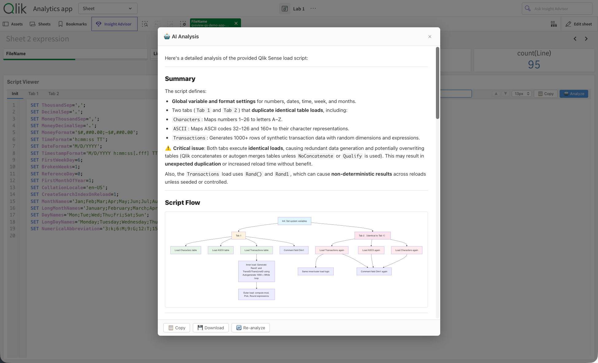

<h1 align="center">QvsView.qs</h1>

<strong>Read-only Qlik load script viewer with syntax highlighting</strong>

<a href="#getting-started">Getting started</a> ·
<a href="https://github.com/ptarmiganlabs/QvsView.qs/discussions">Questions</a> ·
<a href="https://github.com/ptarmiganlabs/QvsView.qs/issues">Report a bug</a> ·
<a href="https://github.com/sponsors/ptarmiganlabs">❤️ Sponsor</a>

Read-only Qlik load script viewer with syntax highlighting — add it to any Qlik Sense sheet to display a field containing app load scripts in a formatted, color-coded code viewer.

Primarily intended for use with **Qlik Sense Enterprise on Windows** (client-managed). Also compatible with **Qlik Sense Cloud**, though the data pipeline for Cloud is more complex (see [docs/getting-started.md](docs/getting-started.md)).

## ❤️ Support the project

QvsView.qs is free and open source, under the MIT licence. If you use it, please consider sponsoring its development: sponsorships pay for maintenance, bug fixes and new features, and keep the project going.

**[❤️ Sponsor Ptarmigan Labs on GitHub](https://github.com/sponsors/ptarmiganlabs)**

Other ways to help:

- ⭐ **Star the repository**: it helps others find the project.
- 💬 **Share your feedback** in [Discussions](https://github.com/ptarmiganlabs/QvsView.qs/discussions): tell us how you use it.
- 🐛 **Report issues** in [Issues](https://github.com/ptarmiganlabs/QvsView.qs/issues).
- 🍴 **Contribute**: pull requests are welcome.

_Maintained by [Göran Sander](https://github.com/mountaindude) and supported by [Ptarmigan Labs](https://ptarmiganlabs.com)._

---

  

---

## Features

- **Syntax highlighting** — color-coded keywords, functions, strings, comments, variables, and field references sourced directly from Qlik's own BNF grammar (~400 keywords and functions across 25 categories, matching the native script editor's color scheme)
- **Section tabs** — automatically detects script sections and renders a clickable tab strip for instant navigation between script sections
- **Search** (Ctrl/Cmd+F) — real-time search with highlighted matches; automatically expands any folded regions that contain a match
- **Code folding** — collapse and expand sections to focus on specific parts of the script; fold state is preserved while navigating
- **Copy to clipboard** — one-click copy of the visible section or the full concatenated script
- **Deprecated function detection** — deprecated Qlik functions are rendered with strikethrough styling, sourced from the BNF definition
- **Runtime BNF** — optionally fetches the authoritative keyword list live from the Qlik Engine API for maximum accuracy
- **AI script analysis** — send the script to Ollama, OpenAI, or Anthropic for AI-powered review; four prompt templates (General, Security, Performance, Documentation); output rendered as Markdown with Mermaid diagrams; results cached in `sessionStorage` for 30 minutes
    - **CDN variant**: Mermaid diagrams require internet access (loaded from jsDelivr)
    - **Air-gapped variant**: Mermaid diagrams work offline (bundled in the extension)
- **Large script support** — paginated `getHyperCubeData` fetching handles arbitrarily large scripts without truncation
- **Multi-app detection** — warns when dimension data comes from multiple apps (the viewer is designed to show a single app's script)

---

## Getting Started

> For a complete walkthrough — from installing the extension to extracting scripts from Sense apps and running AI analysis — see [docs/getting-started.md](docs/getting-started.md).

### Prerequisites

- **Qlik Sense Enterprise on Windows** (client-managed) — May 2025 or later (may work on older versions but is not tested) or **Qlik Sense Cloud**
- Two fields in your data model:
    - One field containing the load scripts' rows (typically loaded from `.qvs` files)
    - One field containing a script identifier, such as the script file name, app name or app ID. Has to be unique across all scripts loaded into the app.

### Download

Each release includes two variants of the extension:

| Release file                       | Description                                                                            | When to use                                   |
| ---------------------------------- | -------------------------------------------------------------------------------------- | --------------------------------------------- |
| `qvsview-qs-v{VERSION}-cdn.zip`    | **CDN variant** — Mermaid.js loaded from jsDelivr at runtime. Small bundle (~57 KB).   | Environments with internet access             |
| `qvsview-qs-v{VERSION}-airgap.zip` | **Air-gapped variant** — Mermaid.js bundled in the extension. Larger bundle (~910 KB). | Air-gapped or network-restricted environments |

1. Go to [**Releases**](https://github.com/ptarmiganlabs/QvsView.qs/releases) and download the variant that matches your environment.
2. Extract the downloaded ZIP. Inside you will find:
    - `readme.txt` — brief release notes (includes the variant name)
    - `LICENSE` — the MIT license
    - `README.pdf` — this documentation as a PDF
    - **`qvsview-qs.zip`** — **this is the actual extension file** that you upload to Qlik Sense

> **Note:** The downloaded file is an outer ZIP that wraps the deployable extension ZIP. Extract the outer ZIP first, then use the inner `qvsview-qs.zip` for installation. Both variants install identically — only the Mermaid loading strategy differs.

### Install in Qlik Sense

**Client-managed (QSEoW):**

1. Open the **Qlik Management Console (QMC)** → Extensions.
2. Click **Import**, select `qvsview-qs.zip` (the inner ZIP from the release package).
3. Open any app in the Sense hub, enter edit mode, and drag **QvsView.qs** from the custom objects panel onto a sheet.

**Qlik Cloud:**

1. Open the **Management Console** → Extensions.
2. Click **Add**, upload `qvsview-qs.zip` (the inner ZIP from the release package).
3. Open any app, enter edit mode, and drag **QvsView.qs** from the custom objects panel onto a sheet.

> **Note**: This guide focuses on client-managed Qlik Sense Enterprise. The extension also installs on Qlik Sense Cloud, but the data pipeline for extracting and loading scripts into Cloud apps is more complex and not covered here. See [docs/getting-started.md](docs/getting-started.md) for the client-managed workflow.

### First Use

1. With the extension on a sheet in edit mode, open the **property panel** and add a **Dimension** — select the field that contains your script rows.
2. Add a second **Dimension** — select the field that contains the script identifier (e.g. file name, app name, or app ID).
3. Optionally adjust viewer settings: font size, line numbers, and other display options.
4. Switch to analysis mode. The script renders with full syntax highlighting.
5. Use the **section tabs** to jump between tabs, press **Ctrl/Cmd+F** to open the search bar, and click the fold indicators in the gutter to collapse sections.

---

## Platform Support

| Platform                                          | Status                           |
| ------------------------------------------------- | -------------------------------- |
| Qlik Sense Enterprise on Windows (client-managed) | **Primary** — full documentation |
| Qlik Sense Cloud                                  | Supported — limited guidance     |

Platform detection is automatic — the extension identifies the environment and adapts accordingly.

---

## AI Analysis

QvsView.qs includes an optional AI-powered script analysis feature. Click the **🤖 Analyze** toolbar button to send your script to a large language model for review. Results are rendered as Markdown with Mermaid diagrams and cached in `sessionStorage` for 30 minutes.

> **Mermaid diagrams:** The CDN variant loads Mermaid.js from jsDelivr at runtime — internet access is required for diagram rendering. The air-gapped variant bundles Mermaid.js locally, so diagrams render without any network access. If Mermaid cannot be loaded in either variant, the raw diagram source is displayed as text.

### Supported Providers

| Provider  | Default endpoint               | Auth             | Best for           |
| --------- | ------------------------------ | ---------------- | ------------------ |
| Ollama    | `http://127.0.0.1:11434`       | None required    | Air-gapped / local |
| OpenAI    | `https://api.openai.com/v1`    | API key (Bearer) | Cloud              |
| Anthropic | `https://api.anthropic.com/v1` | API key (header) | Cloud              |

Endpoints and LLM models can be customized in the property panel, allowing use of self-hosted models or API-compatible services.

### Prompt Templates

| Template      | Focus                                                    |
| ------------- | -------------------------------------------------------- |
| General       | Summary, data flow, Mermaid flowchart, improvement ideas |
| Security      | Credentials, injection risks, file access, data exposure |
| Performance   | `WHERE` clauses, joins, resident loads, memory usage     |
| Documentation | Comprehensive documentation with data model diagrams     |

### Setup

1. Enable **AI Analysis** in the property panel under _AI Analysis → Enable AI Analysis_.
2. Choose a **provider** and configure the endpoint, model (either choose from **Available models** or type directly into **Model**), and API key mode:
    - **Stored** — key saved in the Qlik object properties (convenient but visible to anyone with object access).
    - **Prompt at runtime** — key requested when you click Analyze and cached for the browser session.
3. Optionally set **Analysis scope** (current section or full script) and a **Custom system prompt**.
4. Click **🤖 Analyze** in the viewer toolbar.

See [docs/ai-analysis.md](docs/ai-analysis.md) for full setup details, including Ollama CORS configuration for HTTPS environments.

### Loading Experience

While waiting for the AI response, the modal shows:

- **Cycling humorous quotes** with smooth fade transitions (cycle time is configurable, 3–10 s)
- **Elapsed timer** tracking how long the analysis has been running
- **Snake mini-game** — a retro canvas-based game (WASD or arrow keys) to pass the time

---

## Architecture

Built with [nebula.js](https://qlik.dev/toolkits/nebulajs/) and bundled as a single UMD file via Rollup (no dynamic imports).

| Module                      | Description                                                                   |
| --------------------------- | ----------------------------------------------------------------------------- |
| `src/index.js`              | Supernova entry point — data fetching, layout reactivity, event wiring        |
| `src/syntax/highlighter.js` | Regex-based, stateful tokenizer with multi-line comment/string support        |
| `src/syntax/keywords.js`    | BNF-sourced keyword and function lists (400+ entries, 25 categories)          |
| `src/syntax/tokens.js`      | Token types and CSS color definitions (matching Qlik's native DLE colors)     |
| `src/ui/viewer.js`          | Full HTML renderer — section tabs, toolbar, line gutter, fold gutter, `<pre>` |
| `src/ui/search.js`          | Search overlay: match finding, highlight rendering, folded-region auto-expand |
| `src/ui/ai-modal.js`        | AI analysis modal: loading UX, Snake mini-game, Mermaid diagram rendering     |
| `src/ai/`                   | Provider adapters, prompt templates, response caching, API key management     |
| `src/ext/`                  | Property panel sections (viewer settings, toolbar, AI, about)                 |

---

## Contributing

Pull requests are welcome!

1. Fork the repository and create a feature branch.
2. Run `npm run lint:fix && npm run format && npm test` before committing.
3. Use [Conventional Commits](https://www.conventionalcommits.org/) — `feat:`, `fix:`, `docs:`, `refactor:`, etc.
4. Open a pull request against `main`.

Report bugs or request features via [GitHub Issues](https://github.com/ptarmiganlabs/QvsView.qs/issues/new/choose).

---

## License

[MIT](LICENSE) © Göran Sander / Ptarmigan Labs

See the [LICENSE](LICENSE) file for full license text.
